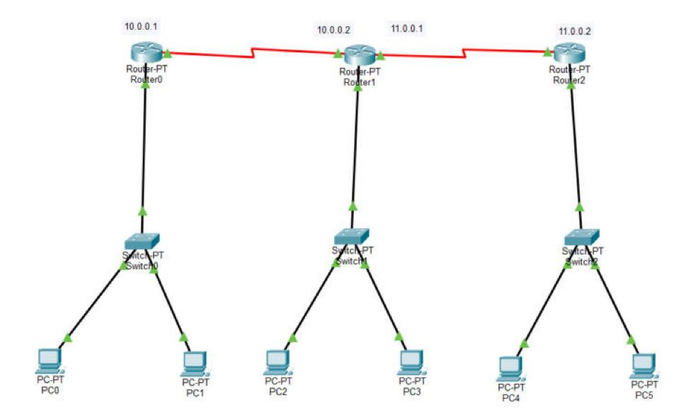
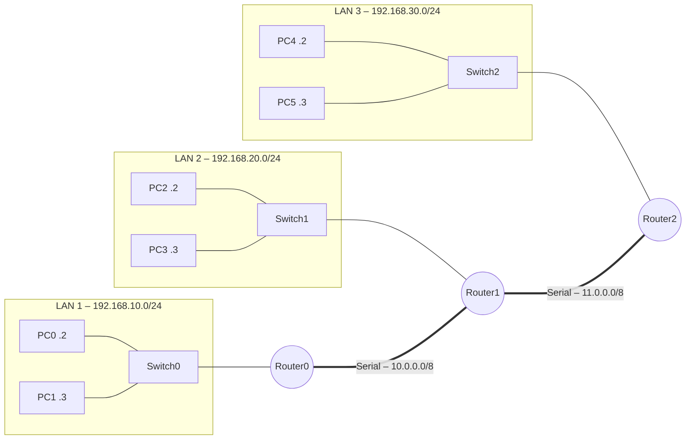

# Routage dynamique RIP – Cisco Packet Tracer

Interconnexion de trois réseaux locaux à travers trois routeurs reliés en série, avec le protocole de routage dynamique **RIP** pour l'échange automatique des routes.


## Topologie

### Capture Packet Tracer



### Schéma logique



## Plan d'adressage

| Équipement | Interface | Adresse IP | Réseau |
|---|---|---|---|
| Router0 | Fa0/0 | 192.168.10.1 /24 | LAN 1 |
| Router0 | Se2/0 | 10.0.0.1 /8 | Lien R0–R1 |
| Router1 | Fa0/0 | 192.168.20.1 /24 | LAN 2 |
| Router1 | Se2/0 | 10.0.0.2 /8 | Lien R0–R1 |
| Router1 | Se3/0 | 11.0.0.1 /8 | Lien R1–R2 |
| Router2 | Fa0/0 | 192.168.30.1 /24 | LAN 3 |
| Router2 | Se3/0 | 11.0.0.2 /8 | Lien R1–R2 |
| PC0 / PC1 | – | 192.168.10.2 / .3 | passerelle 192.168.10.1 |
| PC2 / PC3 | – | 192.168.20.2 / .3 | passerelle 192.168.20.1 |
| PC4 / PC5 | – | 192.168.30.2 / .3 | passerelle 192.168.30.1 |

## Configuration RIP

Chaque routeur annonce ses réseaux directement connectés :

```cisco
! Router1 (routeur central)
router rip
 network 10.0.0.0
 network 11.0.0.0
 network 192.168.20.0
```

Toutes les configurations sont regroupées dans [`CONFIGURATIONS.md`](CONFIGURATIONS.md).

## Compétences mises en œuvre

- Adressage IPv4 et passerelles par défaut
- Liaisons série entre routeurs (WAN)
- Routage dynamique à vecteur de distance (RIP)
- Vérification : `show ip route`, `show ip protocols`, `ping` / `tracert` entre LAN

## Utilisation

1. Ouvrir [`tp-rip.pkt`](tp-rip.pkt) avec **Cisco Packet Tracer 8.2** ou plus récent.
2. Vérifier les tables de routage avec `show ip route` sur chaque routeur (routes marquées `R`).
3. Tester la connectivité de bout en bout, par exemple un `ping 192.168.30.2` depuis PC0.

## Contenu du dossier

| Élément | Description |
|---|---|
| [`tp-rip.pkt`](tp-rip.pkt) | Fichier Cisco Packet Tracer du projet |
| [`CONFIGURATIONS.md`](CONFIGURATIONS.md) | Configuration de chaque équipement et adressage des postes, en un seul fichier |
| [`configs/`](configs/) | Une configuration brute par équipement (`.txt`) |
| [`images/`](images/) | Captures de la topologie |
